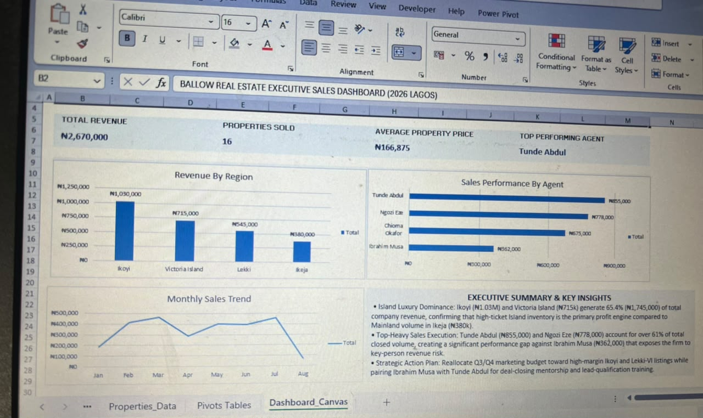

# 🏢 BALLOW Real Estate Executive Sales Dashboard (Lagos, Nigeria)

A fully dynamic, relational executive sales dashboard built from scratch in Microsoft Excel to analyze regional revenue drivers, agent performance metrics, and monthly sales trends for a Lagos real estate portfolio.

## 📊 Dashboard Preview

## 🛠️ Tech Stack & Skills Demonstrated
- **Data Modeling:** Built a relational Power Pivot data model linking `PropertiesTable` and `AgentsTable` via a foreign key (`Agent_ID`).
- **Advanced Formulas:** Utilized `XLOOKUP`, `SUMIF`, and dynamic tie-proof arrays (`TEXTJOIN`/`FILTER`/`MAX`) to handle top-agent rankings automatically.
- **Data Visualization & Formatting:** Localized currency formatting (`₦` - Nigerian Naira), structured a multi-zone PivotChart canvas, and sorted data hierarchically (highest to lowest).
- **Executive Reporting:** Designed dedicated KPI cards and a floating text box for unobstructed executive summaries and strategic action plans.

## 📈 Key Business Insights
1. **Island Luxury Dominance:** Ikoyi (`₦1,030,000`) and Victoria Island (`₦715,000`) account for **65.4% (₦1,745,000)** of total company revenue, proving high-ticket luxury inventory is the primary profit engine compared to Mainland volume in Ikeja (`₦380,000`).
2. **Top-Heavy Sales Execution:** Tunde Abdul (`₦855,000`) and Ngozi Eze (`₦778,000`) drive over **61%** of closed volume, highlighting a key-person revenue dependency compared to Ibrahim Musa (`₦362,000`).
3. **Strategic Recommendation:** Reallocate Q3/Q4 marketing spend toward high-margin Ikoyi and Lekki-VI listings while pairing Ibrahim Musa with Tunde Abdul for deal-closing mentorship and lead qualification.
